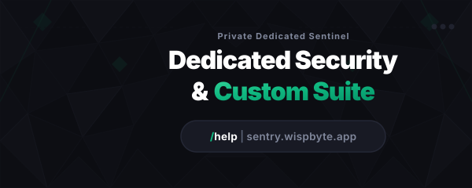

  
  

    <strong>Sentinella Intelligente, Sicurezza &amp; Gestione Community per Discord</strong>
  

  

    
    
    
    
    
  

 

# 🛡️ Sentry

**Sentry** è una sentinella multifunzione all-in-one per Discord, dotata di Intelligenza Artificiale (Llama 3.3 70B), gestione automatica delle partnership, live embed builder, reaction roles, welcomer personalizzato, sistema di ticket, automod avanzato e una **Dashboard Web moderna in stile acciaio nobile**.

🌐 **Dashboard Ufficiale:** [https://sentry.wispbyte.app](https://sentry.wispbyte.app)

---

## ✨ Funzionalità Principali

- **🧠 Sentry AI (Llama 70B)**: Risponde alle menzioni e ai comandi slash con memoria contestuale, intelligenza conversazionale e ricerca web in tempo reale.
- **🤝 Sistema Partnership**: Verifica automatica dei link di invito Discord, rispetto dei requisiti minimi di membri e statistiche aggregate.
- **🎨 Live Embed Builder**: Editor visuale WYSIWYG per creare, salvare e inviare annunci ed embed interattivi direttamente dalla dashboard.
- **🛡️ AutoMod & Sicurezza**: Filtri anti-spam, anti-invite, anti-link e comandi completi di moderazione (`/ban`, `/kick`, `/timeout`, `/warn`, `/clear`, `/nuke`).
- **🎭 Reaction Roles**: Assegnazione e rimozione ruoli tramite pulsanti Discord interattivi ed emoji personalizzate.
- **👋 Welcomer & Auto-Role**: Messaggi di benvenuto con schede grafiche, DM privati e auto-assegnazione ruoli all'ingresso.
- **🎫 Sistema Ticket**: Supporto con canali privati dedicati, transcript automatici e gestione staff.
- **⭐ Leveling & Minigiochi**: Sistema di XP in chat con card `/rank`, `/leaderboard`, gioco del counting, dadi e pesca.

---

## ⚡ Comandi Slash Principali

| Categoria | Comando | Descrizione |
| :--- | :--- | :--- |
| **🧠 AI** | `/ai ask <domanda>` | Pone una domanda diretta a Sentry AI |
| | `/ai search <query>` | Effettua una ricerca web in tempo reale |
| | `/ai reset` | Azzera la memoria del canale corrente |
| | `/ai prompt` | Visualizza o modifica l'identità di Sentry |
| **🛡️ Generale** | `/help` | Centro comandi con link alla dashboard |
| | `/botinfo` | Informazioni su Sentry e statistiche sistema |
| | `/ping` | Latenza del bot e delle API |
| | `/serverinfo` | Informazioni dettagliate sul server |
| **🤝 Partnership** | `/partnership` | Registra e invia una partnership con modal |
| | `/partner config` | Configura canale, ruolo e requisiti |
| | `/partner stats` | Statistiche e cronologia partnership |
| **🎨 Embeds** | `/embed` | Crea e invia annunci embed |
| **🎭 Ruoli** | `/reactionrole button` | Crea un pannello ruoli con pulsanti |
| **👋 Benvenuto** | `/welcomer config` | Imposta canale e messaggi di benvenuto |
| | `/welcomer autorole` | Configura i ruoli automatici all'ingresso |
| **⚔️ Moderazione** | `/ban`, `/kick`, `/timeout` | Sanzioni rapide per violazioni |
| | `/warn`, `/warnings` | Assegna e gestisci gli avvertimenti |
| | `/clear`, `/nuke` | Pulizia messaggi o ricreazione del canale |
| **🎫 Ticket** | `/ticket panel` | Invia il pannello per l'apertura dei ticket |
| **⭐ Community** | `/presentati` | Scheda di presentazione per nuovi membri |
| | `/rank`, `/leaderboard` | Livello XP e classifica del server |

---

## 📜 Licenza
Rilasciato sotto licenza [MIT](LICENSE).
